|  |  |
| -------- | --- |
| **Nama** | Tedi Mulyadi |
| **NIM** | 312510163 |
| **Kelas** | I251B |
| **Mata Kuliah** | Pemrograman web |
| **Dosen** | Agung Nugroho, S.Kom., M.Kom. |  

---
# Praktikum 6 — JavaScript DOM dan Event Handling

## D. Persiapan praktikum

1. Buat folder kerja dengan nama `lab6_dom_event`.
2. Pisahkan struktur halaman ke `index.html`, pengaturan tampilan ke `style.css`, dan kode JavaScript ke `script.js`.
3. Pastikan `index.html` memuat `<link rel="stylesheet" href="style.css">` serta `` agar kedua file terhubung.
4. Jalankan `index.html` melalui browser; pengguna VS Code juga dapat memanfaatkan **Live Server**.
5. Akses **F12 → Console**, uji latihan satu per satu, kemudian amati perubahan tulisan dan respons validasi yang muncul.

## E. Langkah kerja praktikum (Latihan 1–6)

### E.1 — Mengubah teks dengan DOM

Melalui `document.getElementById()`, program mengambil elemen `judul` dan `pesan`, kemudian memperbarui isinya menggunakan `textContent`. Ketika halaman dijalankan, judul menampilkan **Belajar JavaScript DOM** dan paragraf menampilkan **Konten berhasil diubah oleh JavaScript.** Sebuah tombol tambahan memungkinkan pengguna mengganti isi pesan, lalu mengembalikannya seperti semula.

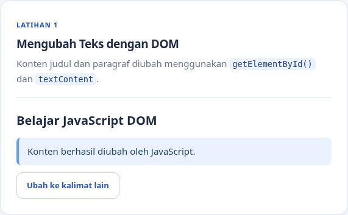

### E.2 — Event `click`

Tombol `tombolAksi` diberi event listener untuk mendeteksi klik. Saat ditekan, elemen `pesanKlik` menampilkan waktu tindakan dengan `new Date().toLocaleTimeString("id-ID")`. Informasi waktunya diperbarui setiap kali tombol diklik kembali.

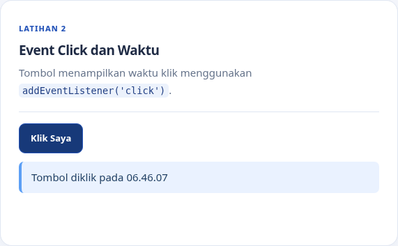

### E.3 — Mengubah kelas dan gaya CSS

Dengan `classList.toggle()`, tombol `tombolGaya` dapat mengaktifkan maupun menonaktifkan kelas `.highlight` dan `.teks-besar`. Kelas `.highlight` mengatur warna tulisan menjadi biru, latar biru muda, garis di sisi kiri, serta padding. Sementara itu, `.teks-besar` menetapkan ukuran tulisan `1.4rem` sesuai modul. Tekan tombol pertama kali untuk menerapkan gaya dan tekan lagi untuk kembali ke kondisi awal.

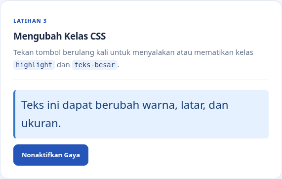

### E.4 — Event `input` dan penghitung karakter

Input `namaInput` dibatasi hingga 40 karakter. Event listener `input` akan menyesuaikan nilai `jumlahKarakter` secara langsung ketika pengguna menulis, menghapus, atau menempelkan teks. Sebagai contoh, teks **Tedi Mulyadi** terhitung sebanyak **12 karakter**.

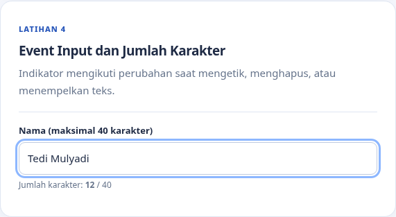

### E.5 — Validasi form pendaftaran

Form menyediakan isian **nama lengkap, email, dan usia**. Saat event `submit` terjadi, `event.preventDefault()` menghentikan pengiriman bawaan browser agar data bisa diperiksa terlebih dahulu. Nama tidak boleh kosong dan harus berisi setidaknya 3 karakter (sesuai pengembangan G.2), email harus mengikuti format yang benar, serta usia wajib berupa bilangan bulat dalam rentang 17–100. Jika semua syarat terpenuhi, pesan keberhasilan ditampilkan dan form dikosongkan kembali. Pengujian mencakup seluruh kolom kosong, nama terlalu pendek, email salah, usia 16 atau 101, usia desimal, dan data yang memenuhi syarat.

**Contoh kondisi gagal (nama kosong):**

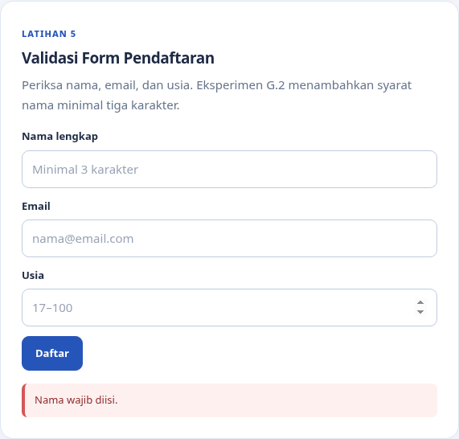

**Contoh kondisi gagal (email tidak valid):**

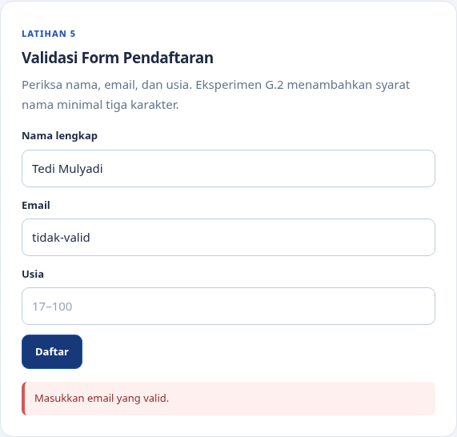

**Contoh kondisi gagal (usia kurang dari 17):**

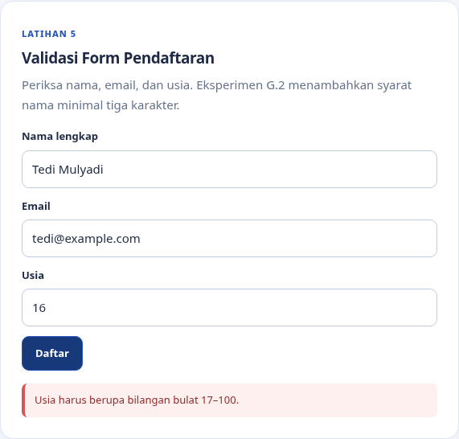

**Contoh kondisi berhasil (data valid):**

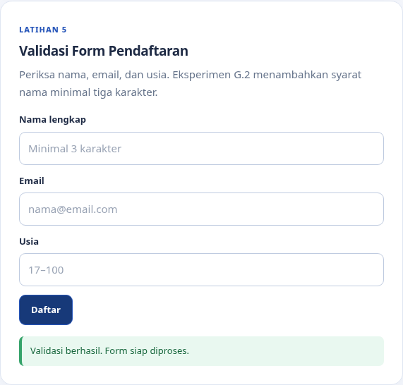

### E.6 — To-do List sederhana

Ketika pengguna menambahkan tugas, JavaScript membentuk elemen `li` melalui `createElement()`. Status tugas bisa diubah menjadi selesai menggunakan kelas `.selesai`, dikembalikan menjadi belum selesai, ataupun dihapus secara individual seperti pada eksperimen G.1. Program tidak menerima masukan kosong. Isi tugas ditampilkan memakai `textContent` agar tidak diperlakukan sebagai kode HTML.

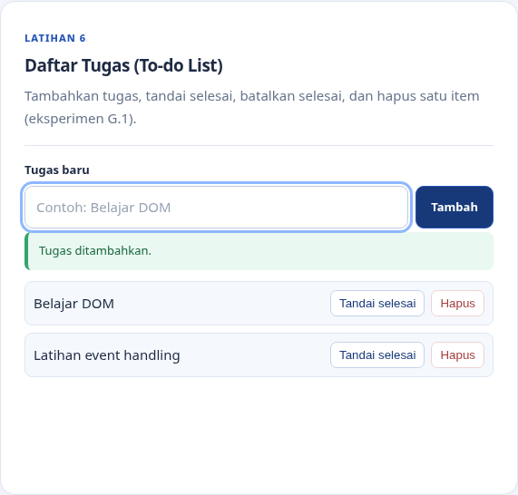

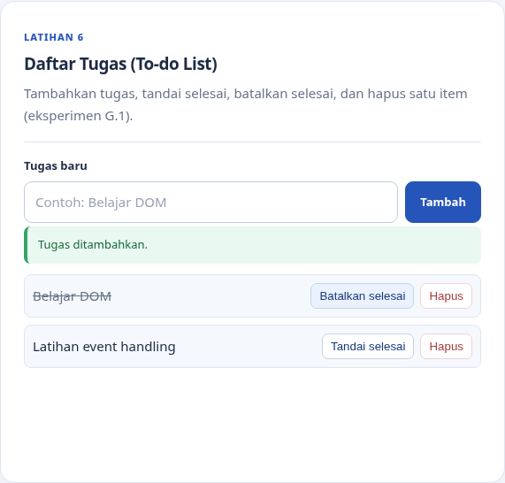

## F. Mini Project — Form Pendaftaran Workshop

Pada form workshop tersedia sedikitnya tiga fitur interaktif yang dikendalikan melalui `addEventListener()`:

1. Pemeriksaan **nama (minimal 3 karakter), email, dan sesi yang dipilih**, dengan informasi gagal atau berhasil ditampilkan pada halaman.
2. Penghitungan panjang nama serta **ringkasan input real-time** yang berubah seiring pengguna mengetik.
3. Pemantauan event `change` pada dropdown sesi supaya sesi terpilih langsung tercatat di ringkasan (berkaitan dengan G.3).
4. Tombol Reset untuk membersihkan isian, jumlah karakter, ringkasan, dan pesan hasil.

Sebagai contoh, tersedia Sesi Pagi (09.00–11.00), Sesi Siang (13.00–15.00), dan Sesi Online (19.00–21.00). Ketiga pilihan tersebut hanya digunakan sebagai simulasi, **bukan jadwal workshop resmi**. Proses pada form masih sebatas validasi di browser dan belum mencakup penyimpanan ke server.

**Tampilan awal:**

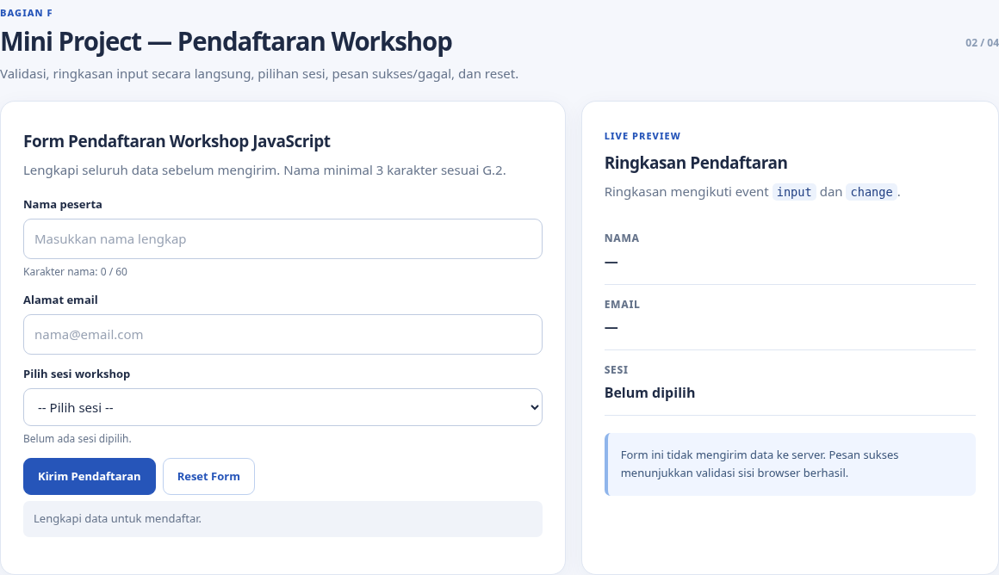

**Email tidak valid:**

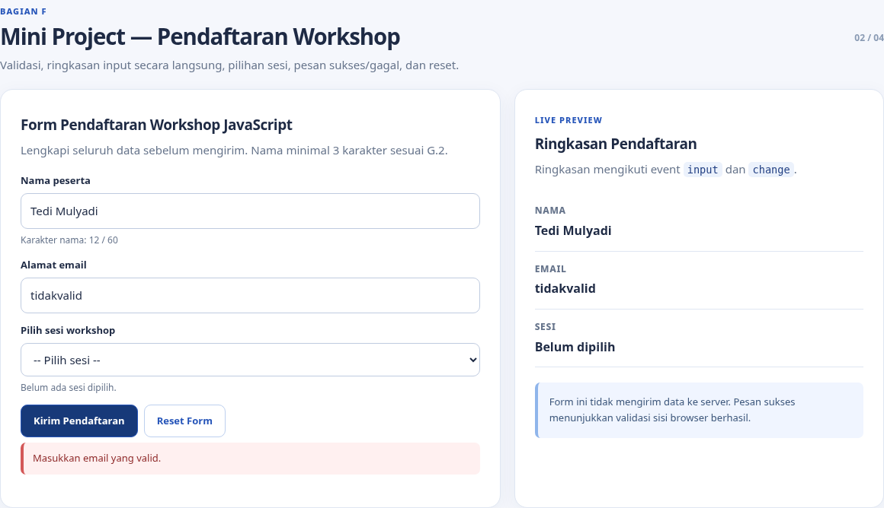

**Sesi belum dipilih:**

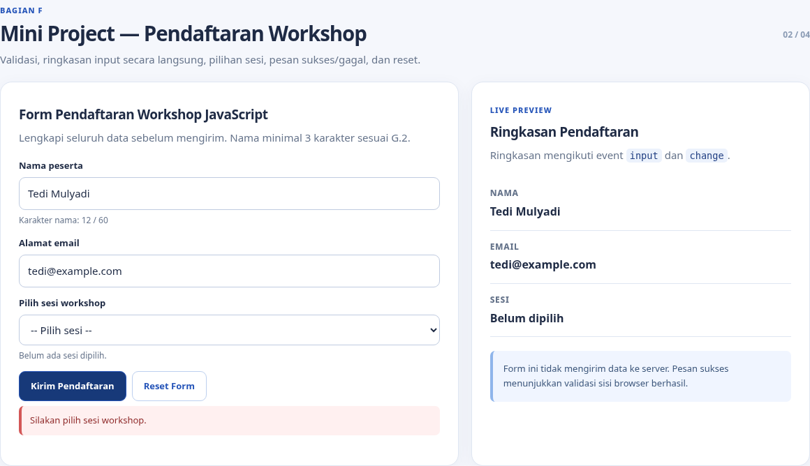

**Pendaftaran valid:**

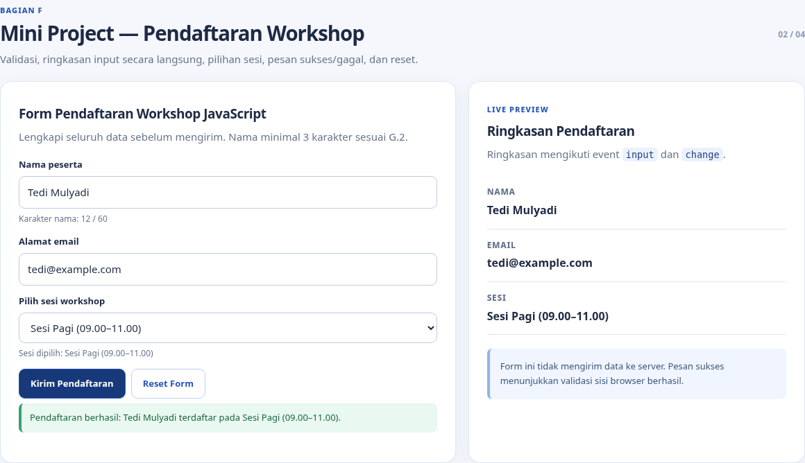

**Form selesai di-reset:**

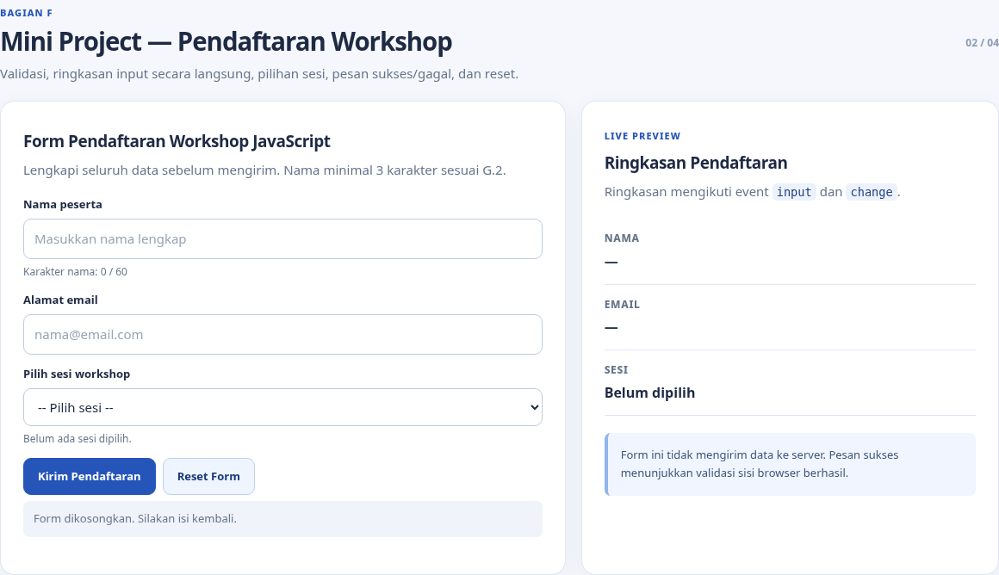

## G. Eksperimen mandiri (1–5)

### G.1 — Hapus item To-do List

Tombol **Hapus** disediakan pada setiap tugas. Saat tombol tersebut ditekan, event `click` menjalankan `item.remove()` untuk menghilangkan item terkait tanpa memengaruhi tugas lainnya.

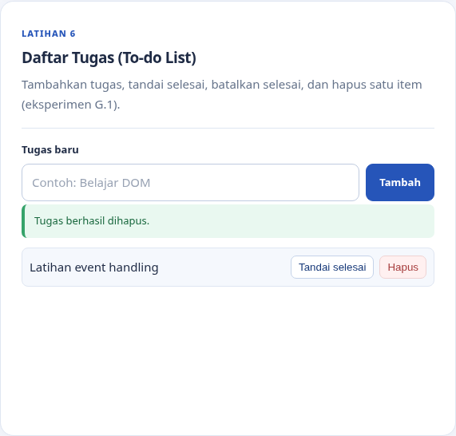

### G.2 — Nama minimal tiga karakter

Program terlebih dahulu membersihkan spasi di awal dan akhir nama dengan `trim()`. Apabila kondisi `nama.length < 3` terpenuhi, pesan **Nama minimal 3 karakter** akan muncul. Pemeriksaan yang sama digunakan dalam form Latihan 5 maupun form workshop.

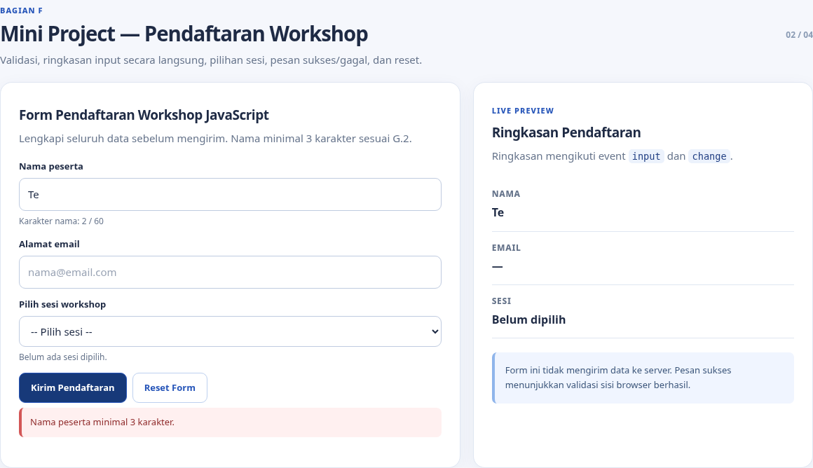

### G.3 — Event `change` untuk sesi workshop

Perubahan pilihan pada dropdown `workshopSesi` memicu `perbaruiRingkasan()` untuk menyesuaikan tulisan **Sesi dipilih** dan informasi pada kartu ringkasan. Proses ini berlangsung tanpa perlu melakukan submit form.

### G.4 — Sembunyikan dan tampilkan paragraf

Untuk mengatur visibilitas paragraf, tombol menjalankan `classList.toggle("hidden-by-class")`. Aturan CSS `.hidden-by-class { display: none !important; }` membuat paragraf tidak terlihat ketika kelas aktif. Saat tombol ditekan lagi, kelas dihapus sehingga paragraf muncul kembali.

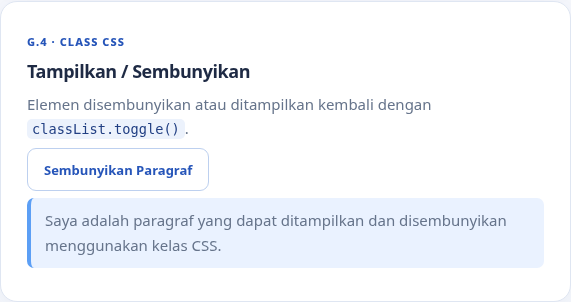

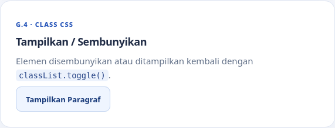

### G.5 — Script di `<head>` tanpa `defer`

Eksperimen dilakukan pada dua halaman berbeda agar fungsi website utama tetap berjalan. Pada halaman **tanpa `defer`**, file `g5_demo.js` dieksekusi ketika `demoTarget` belum terbentuk. Akibatnya, `getElementById()` menghasilkan `null` dan perintah `targetDemo.textContent = ...` memunculkan `TypeError`. Sebaliknya, penggunaan **`defer`** membuat script menunggu hingga HTML selesai diparsing sehingga elemen dapat ditemukan dan teks dapat diubah. Bandingkan kedua hasil dengan membuka tiap halaman dan melihat F12 → Console.

- [`eksperimen/g5_tanpa_defer.html`](eksperimen/g5_tanpa_defer.html) — contoh kesalahan yang memang dibuat untuk keperluan eksperimen.
- [`eksperimen/g5_dengan_defer.html`](eksperimen/g5_dengan_defer.html) — contoh script yang dapat berjalan sebagaimana mestinya.

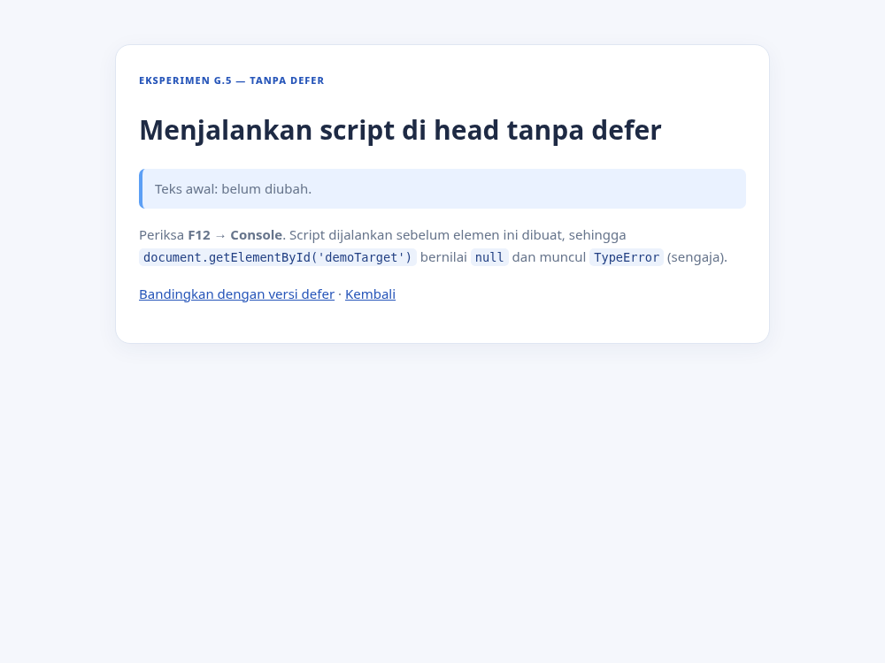

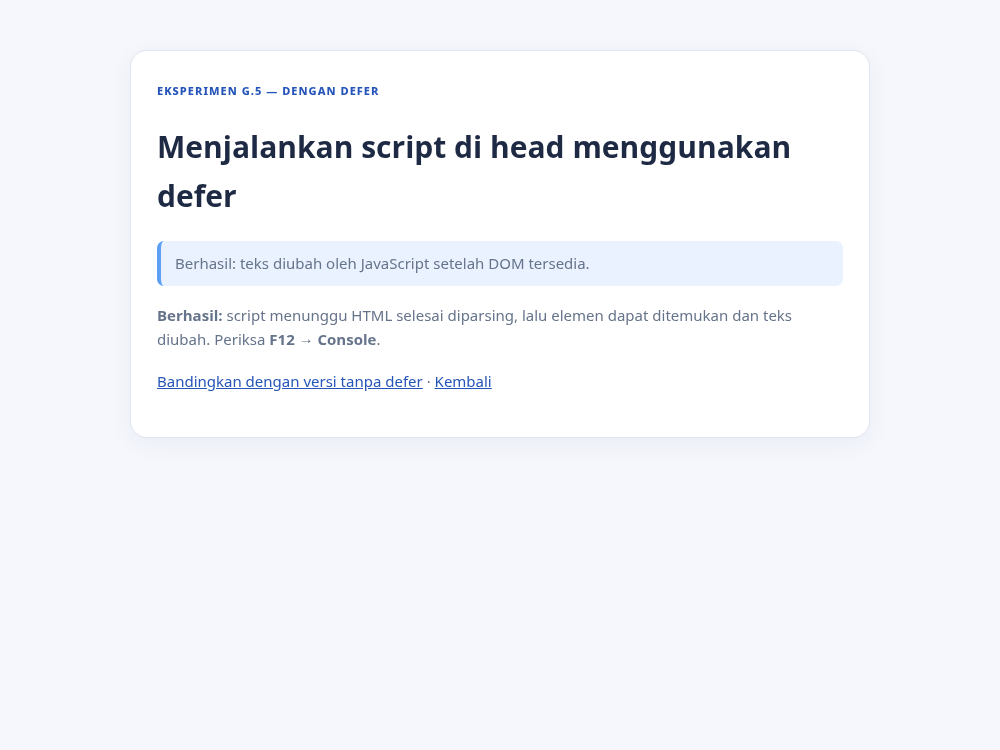

## H. Pertanyaan evaluasi

Pembahasan lengkap untuk **7 soal** tersedia dalam [`JAWABAN_BAGIAN_H.md`](JAWABAN_BAGIAN_H.md) dan dapat dilihat pula melalui panel Evaluasi H pada website. Materinya meliputi konsep DOM, selector, `addEventListener`, `preventDefault`, perbedaan keamanan `textContent` dan `innerHTML`, penggunaan `classList.toggle`, serta contoh pengujian validasi form.

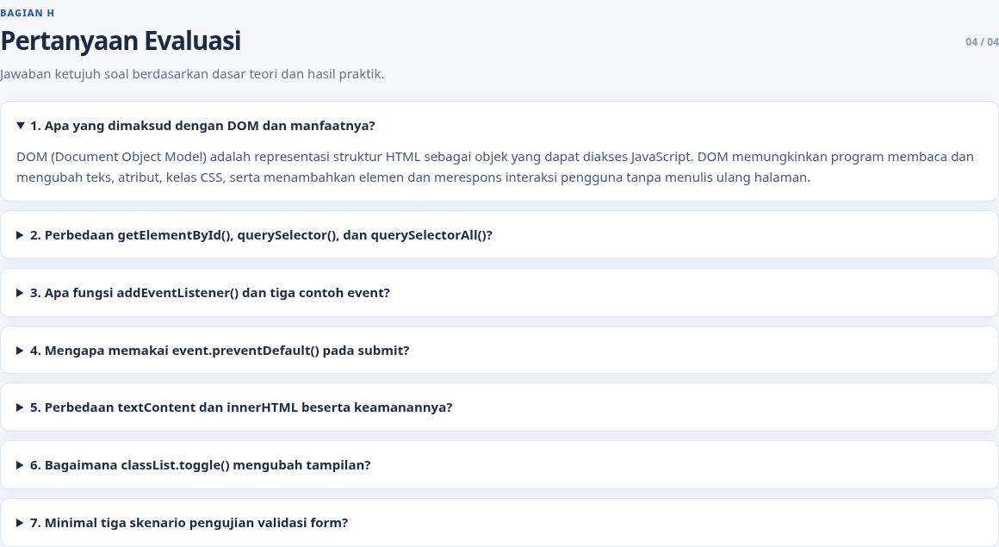

## Pengujian dan hasil

**Tampilan mobile:**

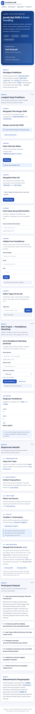

## Kesimpulan

Penerapan DOM dan event handling pada JavaScript memungkinkan halaman memperbarui tulisan maupun tampilan CSS secara langsung, merespons interaksi pengguna, memeriksa isian form, dan menghadirkan fitur aplikasi sederhana. Penggunaan `defer` membantu memastikan elemen HTML sudah tersedia ketika script berjalan, sedangkan `textContent` dipilih untuk menampilkan teks dari pengguna tanpa menafsirkannya sebagai HTML.